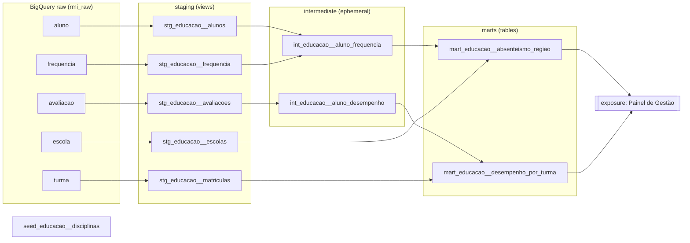
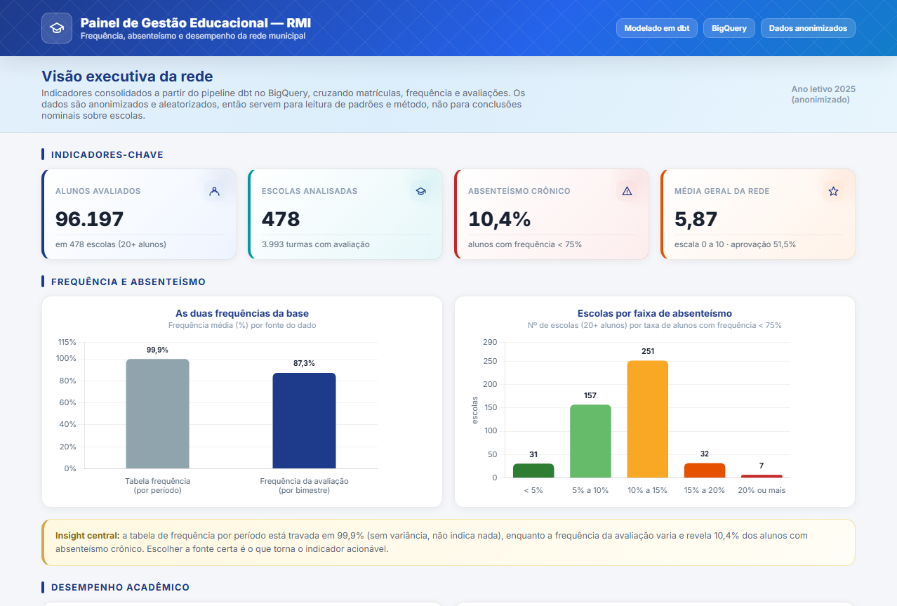

# Desafio RMI - Projeto dbt (Educação)

Solução do desafio técnico de Cientista de Dados do **Registro Municipal Integrado (RMI)**: um projeto `dbt-core` + `dbt-bigquery` que transforma dados educacionais anonimizados em camadas analíticas confiáveis (staging, intermediate, marts), com estratégia de testes focada em qualidade e documentação de ponta a ponta.

O que puxou as decisões aqui não foi a quantidade de models, e sim entender os dados antes de modelá-los. Cada escolha de modelagem partiu de algo concreto que apareceu na exploração (um tipo estranho de ID, uma coluna de frequência sem variância, chaves que não casam entre tabelas), e os testes existem justamente para proteger esses pontos.

---

## Sumário

- [Arquitetura e lineage](#arquitetura-e-lineage)
- [Achados de qualidade dos dados](#achados-de-qualidade-dos-dados)
- [Decisões de arquitetura](#decisões-de-arquitetura)
- [Estratégia de testes](#estratégia-de-testes)
- [Análise dos resultados](#análise-dos-resultados)
- [Visualização (painel de gestão)](#visualização-painel-de-gestão)
- [Como reproduzir](#como-reproduzir)
- [Estrutura do repositório](#estrutura-do-repositório)
- [Trade-offs e próximos passos](#trade-offs-e-próximos-passos)

---

## Arquitetura e lineage

O fluxo segue a convenção de camadas recomendada pela dbt Labs: fontes brutas no BigQuery, limpeza em `staging` (views), regras de negócio em `intermediate` (ephemeral) e tabelas de consumo em `marts` (tables).



Nomenclatura: `camada_dominio__entidade` (ex: `stg_educacao__alunos`, `int_educacao__aluno_frequencia`, `mart_educacao__absenteismo_regiao`). O duplo underscore separa o domínio da entidade, padrão que facilita busca e organização quando o projeto cresce para outros domínios (saúde, assistência social).

---

## Achados de qualidade dos dados

A análise exploratória (ver `notebooks/eda.ipynb`) revelou características que **moldaram as decisões de modelagem**. Esses achados são, na minha leitura, o ponto central do desafio.

| # | Achado | Evidência | Impacto na modelagem |
|---|--------|-----------|----------------------|
| 1 | `id_aluno` é `BYTES` (hash de 17 bytes), não string | Tipo físico no Parquet | `TO_HEX()` no staging gera chave STRING estável e legível |
| 2 | A tabela `turma` é, na prática, a de **matrículas** | 1 linha por aluno, só `ano/id_turma/id_aluno`; sem série/turno (apesar do README do desafio citar) | Renomeada para `stg_educacao__matriculas` |
| 3 | `avaliacao` está em formato **wide** | Uma coluna por disciplina (`disciplina_1..4`) | `UNPIVOT` no staging para formato long |
| 4 | `disciplina_3` (Inglês) é **100% nula** na avaliação | 0 de 221.687 notas preenchidas | Teste documenta a ausência; intermediate ignora notas nulas |
| 5 | Há **dois** campos de frequência: a tabela `frequencia` varia só entre **97,3% e 100%** (sem sinal), mas `avaliacao.frequencia` varia de **0 a 100%** (média 89%, desvio 12) | Tabela `frequencia`: 0 registros < 75%. `avaliacao.frequencia`: 10,4% dos alunos < 75% | Absenteísmo medido pela `avaliacao.frequencia` (com sinal); tabela `frequencia` mantida como contraste |
| 6 | `frequencia.id_turma` tem **~12% de órfãos** vs matrícula | 338.536 de 2,7M linhas | Joins de fato feitos por `id_aluno`; relationship de turma como `warn` |
| 7 | Duplicatas exatas de grão | ~2,6 mil em `frequencia`; ~34 em `avaliacao` | Dedup com `row_number()` no staging |
| 8 | `bairro` do aluno tem nulos | 68 de 97.044 (~0,07%) | Teste customizado tolera até 1% (severidade `warn`) |

Volumetria: `aluno` 97.044, `escola` 1.558, `matriculas` 97.044 (17.311 turmas), `avaliacao` 221.687 (wide) → ~887 mil (long), `frequencia` 2,7 milhões.

**Validação pelo dicionário oficial da fonte.** Após concluir a análise exploratória, localizei o `schema.yml` oficial publicado junto aos dados (`gs://case_vagas/rmi/schema.yml`). Ele confirma, pela própria fonte, decisões que eu havia tomado por inferência:

- `avaliacao.frequencia` é descrita como *"percentual de frequência geral do aluno no bimestre (campo original da tabela de avaliação)"*, enquanto a frequência da tabela `frequencia` é um valor derivado (*"calculado como 100 - (faltas_disciplina / dias_letivos)"*). Isso respalda o uso da `avaliacao.frequencia` como sinal de absenteísmo (achado 5).
- `disciplina_3` é oficialmente *Língua Estrangeira (Inglês)* (achado 4).
- O ano letivo original é **2025**, anonimizado de forma determinística para 2000.
- As notas receberam *jitter* determinístico de ±0,2, e `bimestre` vem de `id_coc` (1 a 4).

---

## Decisões de arquitetura

**Materializações por camada.** Cada camada tem um papel diferente, então materializei cada uma de um jeito:

- O `staging` ficou como **view**. Ele apenas limpa e padroniza a fonte, não compensa guardar isso em disco, e a view sempre reflete o dado mais atual. Na prática, funciona como um contrato de limpeza.
- O `intermediate` ficou como **ephemeral**: a lógica de negócio é reaproveitada dentro dos marts na forma de CTE, sem criar tabelas intermediárias que ninguém consulta direto e que só ocupariam espaço no warehouse.
- Os `marts` são **table**, porque é o que o BI vai consultar com frequência, então precisa ser rápido e estável. O `mart_educacao__absenteismo_regiao` ainda usa `cluster_by = bairro_id`, já que o filtro mais comum ali é por região.

**Chave de join canônica.** `id_aluno` concilia 100% entre todas as tabelas, enquanto `id_turma` da frequência não. Por isso toda consolidação de fato (frequência, desempenho) é feita por `id_aluno`, e a escola do aluno é atribuída pela **escola predominante** (maior contagem de registros de frequência), não pela turma.

**Tratamento de nulos e tipos.** Datas chegam como STRING (`YYYY-MM-DD`) e são convertidas com `SAFE.PARSE_DATE`. Notas ausentes são mantidas como `NULL` (a ausência é legítima), e os testes de range usam `where: nota is not null`.

**Parâmetros centralizados.** Limiares de negócio (frequência mínima de 75%, nota 0 a 10) vivem em `vars` no `dbt_project.yml`, evitando números mágicos espalhados pelo SQL.

**Seed + macro para disciplinas.** O de/para `disciplina_1 → Português` existe como macro (`nome_disciplina`, aplicada no SQL, DRY) e como seed (`seed_educacao__disciplinas`, para documentação e eventuais `relationships`).

---

## Estratégia de testes

Priorizei testar o que, se estivesse errado, derrubaria alguma conclusão: as chaves de grão, as relações que sustentam os joins e os domínios fechados. Onde um problema já é conhecido e tolerável (os órfãos de turma e os nulos de bairro), usei `severity: warn` para acompanhar sem travar o build.

**Testes genéricos (schema.yml)**

| Teste | Aplicado em | O que protege |
|-------|-------------|---------------|
| `unique` + `not_null` | `aluno_id` (alunos/matrículas), `escola_id`, `turma_id`/`escola_id` (marts) | garante o grão declarado de cada model |
| `relationships` | frequência/avaliação → aluno; frequência → escola | integridade referencial nas chaves confiáveis |
| `relationships` (`severity: warn`) | frequência → matrícula via `turma_id` | monitora os ~12% de órfãos sem quebrar o pipeline |
| `accepted_values` | faixa etária, bimestre (1 a 4), disciplinas, ano letivo (2000), faixa de tamanho de turma | trava domínios fechados |
| `dbt_utils.accepted_range` | frequência (0 a 100), notas (0 a 10), taxas (0 a 1) | faixas numéricas válidas |
| `dbt_utils.unique_combination_of_columns` | avaliações e desempenho | unicidade do grão composto |
| `proporcao_nulos_abaixo_de` (customizado) | `bairro_id` do aluno | tolera uma fração conhecida de nulos e só avisa quando a qualidade degrada |

O teste customizado vive em `macros/generic_tests/`. Diferente de um `not_null`, ele permite monitorar o `bairro_id` (que tem ~0,07% de nulos) sem travar o build enquanto o problema estiver dentro do limite.

**Testes singular de regra de negócio (`tests/`)**

1. `assert_periodo_frequencia_coerente`: nenhum registro pode ter `data_inicio > data_fim`. Datas incoerentes invalidariam qualquer cálculo temporal.
2. `assert_aluno_frequencia_sem_duplicatas`: após a dedup, o grão da frequência precisa ser único, pré-condição para agregações corretas nos marts.
3. `assert_todo_aluno_com_nota_tem_matricula`: nenhum aluno pode ter nota sem matrícula correspondente, o que indicaria lançamento indevido ou falha de integração entre sistemas.

---

## Análise dos resultados

**Absenteísmo por região.** A pergunta dos gestores é quais regiões concentram alunos com frequência abaixo de 75%. O caminho óbvio seria a tabela `frequencia`, mas, ao explorar os dados, descobri que ela não tem variância (fica entre 97% e 100%, o que daria taxa zero em toda a rede). A frequência com sinal está em outro campo: `avaliacao.frequencia`, a frequência geral por bimestre, que varia de 0 a 100% (média 89%). Construí o mart sobre essa fonte, mantendo a frequência da tabela `frequencia` como contraste. Com isso os números finalmente mostram diferença entre as escolas: cerca de **10,4% dos alunos** têm frequência média abaixo de 75%, e a taxa vai de **0% a 33% entre as escolas** (478 escolas com 20 ou mais alunos, média de 10,5%). Essa escolha de fonte, e o motivo de descartar a tabela `frequencia`, é parte central do raciocínio analítico documentado. O dicionário oficial da fonte (`rmi/schema.yml`) confirma posteriormente que `avaliacao.frequencia` é o campo *original* de frequência, enquanto a tabela `frequencia` traz um valor derivado (`100 - faltas_disciplina / dias_letivos`), o que reforça a escolha.

**Desempenho por tamanho de turma.** Como `série` e `turno` não existem nos dados, adaptei a pergunta sugerida para a dimensão que é derivável: o **tamanho da turma** (contagem de matrículas). O mart cruza o tamanho com a média de notas e a taxa de aprovação, permitindo investigar se turmas maiores se associam a desempenho diferente. A correlação observada é positiva (Pearson de 0,44), mas, por ser dado aleatorizado, foi documentada como provável artefato (turmas minúsculas têm poucas notas e mais ruído), não como relação causal.

---

## Visualização (painel de gestão)

Os marts já ficam prontos para consumo em BI. Por serem dados anonimizados e estáveis, podem ser conectados em um clique ao **Looker Studio** (nativo do BigQuery) ou a qualquer dashboard, sem transformação adicional.

Como demonstração, consolidei os indicadores em um painel executivo (HTML + Chart.js, também publicado como web app em Google Apps Script). Ele resume os KPIs da rede, o contraste entre as duas frequências, a distribuição de escolas por faixa de absenteísmo e o desempenho por tamanho de turma, com a ressalva de anonimização sempre visível.



A consolidação dos números (a partir do dataset `rmi_dev_marts` no BigQuery) está em `docs/painel/exportar_consolidado.py`, e o painel em `docs/painel/`.

---

## Como reproduzir

Pré-requisitos: Python 3.9+, uma conta Google Cloud (o **BigQuery Sandbox** gratuito basta) e o `gcloud` CLI (para autenticação local).

```bash
# 1. Ambiente Python
python -m venv .venv && source .venv/bin/activate   # Windows: .venv\Scripts\activate
pip install -r requirements.txt

# 2. Autenticação no GCP
gcloud auth application-default login
export GCP_PROJECT="seu-projeto-sandbox"             # Windows PS: $env:GCP_PROJECT="..."

# 3. Ingestão dos Parquet do GCS para o dataset raw no BigQuery
python scripts/load_to_bigquery.py --dataset rmi_raw --location US

# 4. Configurar o profile do dbt
cp profiles.yml.example ~/.dbt/profiles.yml          # e ajuste project/dataset/location

# 5. Instalar packages e rodar o projeto
dbt deps
dbt build            # seed + run + test de todas as camadas
# ou, passo a passo:
dbt seed
dbt run
dbt test
dbt source freshness

# 6. Documentação navegável (lineage interativo)
dbt docs generate && dbt docs serve
```

O bucket é público, então a ingestão não exige credenciais extras além do acesso ao seu próprio projeto BigQuery de destino.

---

## Estrutura do repositório

```
desafio-rmi-ds/
├── README.md
├── dbt_project.yml              # configs, vars de negócio, materializações
├── packages.yml                 # dbt_utils, dbt_expectations, codegen
├── profiles.yml.example         # targets dev (oauth) e ci (service account)
├── requirements.txt
├── .github/workflows/ci.yml     # dbt build a cada PR/push
├── scripts/
│   ├── load_to_bigquery.py      # ingestão GCS -> BigQuery (recomendado)
│   └── load_to_bigquery.sh      # alternativa com bq CLI
├── seeds/
│   ├── seed_educacao__disciplinas.csv
│   └── _seeds.yml
├── macros/
│   ├── nome_disciplina.sql                     # de/para de disciplina (DRY)
│   └── generic_tests/
│       └── test_proporcao_nulos_abaixo_de.sql  # teste genérico customizado
├── models/
│   ├── staging/educacao/
│   │   ├── _educacao__sources.yml   # sources + freshness (metadados)
│   │   ├── _educacao__models.yml    # schema + testes do staging
│   │   ├── stg_educacao__alunos.sql
│   │   ├── stg_educacao__escolas.sql
│   │   ├── stg_educacao__matriculas.sql
│   │   ├── stg_educacao__frequencia.sql
│   │   └── stg_educacao__avaliacoes.sql
│   ├── intermediate/educacao/
│   │   ├── _int_educacao__models.yml
│   │   ├── int_educacao__aluno_frequencia.sql
│   │   └── int_educacao__aluno_desempenho.sql
│   └── marts/educacao/
│       ├── _marts_educacao__models.yml
│       ├── _marts_educacao__exposures.yml
│       ├── mart_educacao__absenteismo_regiao.sql
│       └── mart_educacao__desempenho_por_turma.sql
├── tests/                       # 3 testes singular de regra de negócio
├── notebooks/eda.ipynb          # análise exploratória (DuckDB)
└── data/                        # Parquet locais (gitignored)
```

---

## Trade-offs e próximos passos

**Trade-offs assumidos**

- `intermediate` como ephemeral favorece um warehouse limpo, ao custo de não poder inspecionar a tabela intermediária isoladamente. Dado o volume atual, compensa.
- A escola do aluno foi resolvida por "escola predominante". É uma heurística; o ideal seria uma regra de negócio oficial de vínculo aluno-escola, que os dados não fornecem.
- Mantive a relação frequência → matrícula como `warn` em vez de remover as linhas órfãs: prefiro tornar o problema visível a mascará-lo silenciosamente.

**O que eu faria com mais tempo**

- Materializar `frequencia` como **incremental** particionada por mês, já que é a maior tabela (2,7M linhas) e cresceria em produção.
- Adicionar **data contracts** (`contract: enforced`) nos marts para travar schema e tipos.
- Snapshots (SCD2) para dimensões que mudam (aluno muda de turma/escola ao longo do ano).
- Mais testes do `dbt_expectations` (distribuição de notas, cardinalidade esperada por bimestre).
- Investigar a origem dos ~12% de turmas órfãs na frequência com a equipe dos sistemas de origem.
